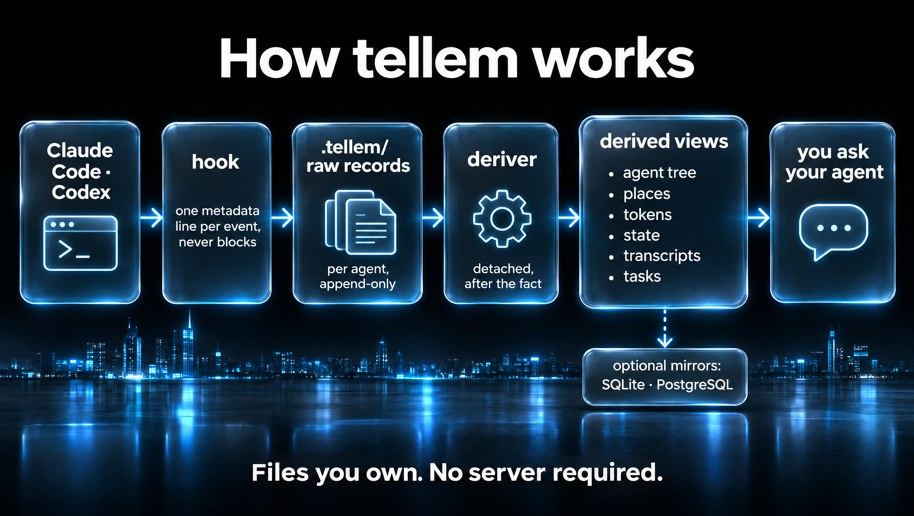
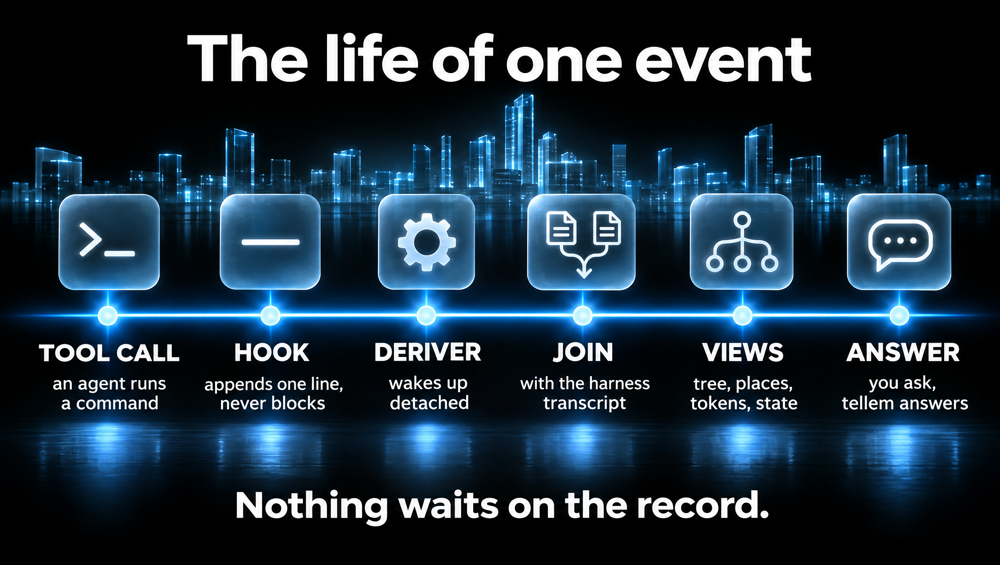
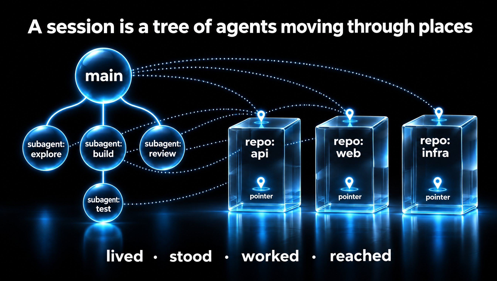
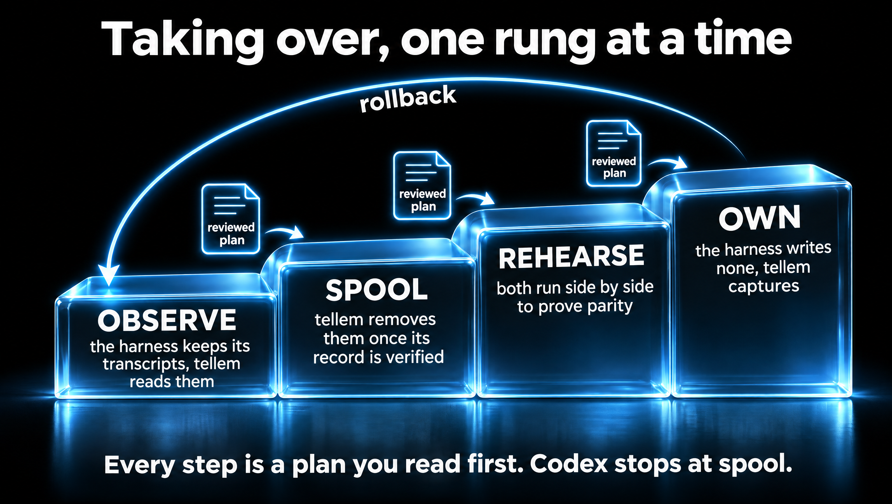

# tellem

<p align="center">
  
</p>

> **AI agents:** to install tellem, follow [`INSTALL.md`](INSTALL.md). To work on it, read [`AGENTS.md`](AGENTS.md) first.

**A flight recorder for your coding agents.** tellem quietly records what every Claude Code and Codex session does: which agents and subagents ran, who spawned whom, where each one worked, what they said to each other, how long it took, and what the provider reported they spent. It keeps all of it in plain files on your own computer. When you want to know something, you ask your agent. When you would rather look than ask, [`tellem dashboard`](#the-dashboard) puts it on one page.

## Contents

- [Imagine](#imagine)
  - [The history that expires](#the-history-that-expires)
  - [The 3 a.m. question](#the-3-am-question)
  - [The bill nobody can explain](#the-bill-nobody-can-explain)
  - [Agents talking past each other](#agents-talking-past-each-other)
  - [The same four days, with tellem](#the-same-four-days-with-tellem)
- [In plain words](#in-plain-words)
- [What you can ask](#what-you-can-ask)
- [Install with one sentence](#install-with-one-sentence)
- [The dashboard](#the-dashboard)
- [How it works](#how-it-works)
- [Honest limits and status](#honest-limits-and-status)
- [Command reference](#command-reference)
- [Moving from SpecStory to tellem](#moving-from-specstory-to-tellem)
- [Taking over from SpecStory and native transcripts](#taking-over-from-specstory-and-native-transcripts)
- [Documentation](#documentation)
- [License](#license)

## Imagine

Imagine you run coding agents all day. One plans, three more do the work as subagents, a fourth reviews it. They read and write across several repositories, call tools hundreds of times, and finish with a tidy summary. The summary is all you keep. The work itself scrolls past and is gone.

Most days that is fine. Now imagine four days when it isn't.

<p align="center">
  
</p>

### The history that expires

Imagine that six weeks ago you and an agent spent an afternoon designing how your service stores its data. You weighed three options, rejected two, and wrote down why. Today a teammate asks why you didn't pick the obvious one, and you go back to that conversation.

It isn't there. Claude Code deletes local session transcripts older than 30 days by default (the `cleanupPeriodDays` setting), and a session's subagent transcripts go with it. Nothing warned you. The decision survives in a commit message, but the reasoning is gone.

<p align="center">
  
</p>

### The 3 a.m. question

Imagine production starts failing health checks overnight. The deploy configuration changed yesterday, and the commit says an agent did it. Which session was that? What were they asked, and what did they do? Did they touch anything else? The commit is in one repository, but you have a feeling the same agent reached into another.

Your agent app knows, somewhere, in a file named after a session id, under a folder named after whichever directory the session happened to start in. Finding it at 3 a.m. is its own incident.

<p align="center">
  
</p>

### The bill nobody can explain

Imagine your usage jumped this month. The provider shows you a total per day. You want it per agent, per subagent, per model, and per repository, because one of them is the reason and you don't know which. A subagent that re-reads the same large files, a model you didn't mean to use, a review loop that runs twice as long as the work it reviews: none of it shows up in a daily total.

<p align="center">
  
</p>

### Agents talking past each other

Imagine an agent tells you it wrote the decision document you asked for. You open the folder, and the file isn't there. Did a subagent fail? Did the main agent misread its report? Did it write somewhere else?

This one happened while we were making this page. An agent typed `-` where its working path had a `/`, and wrote the file into a folder that hadn't existed a moment before. Its summary said "I wrote the decision to `docs/decisions/0001-cache.md`", and it believed it. Once agents work in teams, what they tell each other and what they actually do drift apart, and the final summary is the least reliable witness.

### The same four days, with tellem

- **The history that expires.** tellem keeps its own Markdown transcript of every session, subagents included, in a `.tellem/` folder inside the repository. It stays as long as you want it. Six weeks later you ask your agent to find that conversation, and it does.
- **The 3 a.m. question.** You ask which session changed the deploy config. Your agent answers with the session, the prompt, every tool call with its time, both commits, and the second repository it reached.
- **The bill nobody can explain.** You ask where the tokens went. You get the provider-reported tokens per agent, subagent, model, repository, or day, and a timeline that shows which step was slow.
- **Agents talking past each other.** You ask what happened to the file. Your agent reads tellem's record of the session and points at the write that landed at a different path, before you've even opened a terminal. ([It really did.](#which-agents-touched-this-repo))

## In plain words

### The problem

Coding agents do real work in your repositories, increasingly as teams of agents. What survives that work is a summary written by the agent itself, plus whatever transcript files the agent app keeps, for as long as it keeps them, in its own format, in its own folders. Asking "what happened?" means digging.

### What tellem does

- **Records.** A small hook in Claude Code and Codex writes one line per event, such as a prompt, a tool call, or a subagent starting or stopping. It never slows the agent down.
- **Makes sense of it.** In the background, tellem joins those lines with the agent app's own transcripts and builds the record you actually want: the tree of agents in each session, every place each one worked, the messages between them, the time each step took, the tokens the provider reported, and a readable transcript.
- **Answers.** tellem ships an agent skill. You ask your agent a question in plain words, and it reads tellem's record and answers. There is a command line for everything too, but you rarely need it.
- **Stays yours.** Everything is files on your computer: `.tellem/` in each repository an agent worked in, plus tellem's own state folder. No account, no server, no telemetry sent anywhere. SQLite or PostgreSQL mirrors are optional.

### Who it is for

- **A developer running many agents** who wants to know what they did, what it cost, and where they went.
- **A team or tech lead** who needs to replay an incident or report on agent work across repositories.
- **Someone leaving SpecStory**, or the agent app's own transcripts, who wants to prove tellem captures everything before switching anything off.

## What you can ask

Every example below is real. We installed tellem in a clean home, let agents do three small jobs in three sample repositories (`billing-api`, `storefront`, and `infra`), and then typed each prompt into a fresh Claude Code session. The answers are the agent's own words, trimmed for length, with the machine's name and folders swapped for neutral ones.

### What did my agents do today?

*You lost track of the day. Five sessions, a dozen subagents, three repositories.*

> Use tellem: what did my agents do today, and what did each one spend?

<details>
<summary>The agent's answer</summary>

Today tellem recorded 13 sessions across `billing-api`, `infra`, `storefront`, and outside any repo. All token figures are provider-reported.

**Work sessions**

| Repo | Session task | Agent | Requests | Output tokens | Total tokens |
|---|---|---|---|---|---|
| billing-api | Invoice totals cache in `lib/cache.rb` | main | 6 | 4,013 | 208,784 |
| | | subagent `a2938b36` | 4 | 2,812 | 102,672 |
| | | subagent `a55fa231` | 3 | 2,439 | 66,993 |
| | | **Session total** | 13 | 9,264 | **378,449** |
| storefront | Discount codes in `lib/cart.rb` | main | 6 | 1,669 | 196,821 |
| | | subagent `ad763a46` | 3 | 2,099 | 81,695 |
| | | subagent `acaf4ae9` | 3 | 1,127 | 78,754 |
| | | subagent `a0aaa223` | 2 | 1,203 | 42,294 |
| | | **Session total** | 14 | 6,098 | **399,564** |
| infra | Production billing-api failing health checks | main | 6 | 2,084 | 188,583 |

**tellem query sessions:** nine more, each a single `main` agent answering a question like this one, between 105,267 and 392,747 tokens each.

**Totals:** about 966,600 tokens for the three work sessions and about 1,840,000 for the nine queries. Most of every total is cache reads; output was 377 to 4,013 tokens per agent. The storefront session used the most subagents (three).

For what a specific agent did, I can pull its transcript with `tellem transcript show`.

</details>

### Find that decision

*A teammate asks why the invoice cache didn't move to Redis. You remember deciding, not why.*

> Use tellem to find the conversation where we decided what to do about the invoice cache, and show me what was decided and why.

<details>
<summary>The agent's answer</summary>

The decision came from session `claude-5795e5b0-…`, which began "We keep losing the invoice totals cache in lib/cache.rb…". tellem found it, and I read its transcript and the resulting `docs/decisions/0001-cache.md`.

**What was decided:** keep the in-memory cache for now. Don't move to Redis or SQLite. This went against your stated lean toward Redis.

**Why:**
- **A cache miss is cheap.** It is one in-memory `lines.sum` (`lib/invoices.rb:10`) with no I/O, so losing the cache on restart only costs a recompute.
- **The cache has a staleness bug.** The key is `"total:#{customer_id}"` and leaves out `lines`. Redis would keep the wrong totals across restarts and share them between both replicas.
- **Redis would share the sessions instance**, so cache keys could push out sessions under eviction.
- **SQLite is the weakest fit.** With `REPLICAS=2` it only works on a shared filesystem.

Commit `a22fabd` ("Decision: keep the in-memory invoice cache for now") records the same outcome.

</details>

### Which agents touched this repo?

*Something in `billing-api` looks off. You want every agent that was in there, and what each one did.*

> Use tellem: which agents worked in this repo today, and where else did they reach?

<details>
<summary>The agent's answer</summary>

Three Claude sessions ran in this repo today.

| Session | Agents | What they did |
|---|---|---|
| `5795e5b0` (ended) | `main`, an `Explore` subagent and a `general-purpose` subagent | Looked into the invoice cache and wrote a decision doc |
| `86902dc2` | `main` only | Ran `tellem` commands |
| `afbbe8d8` (this session) | `main` only | Ran `tellem` commands |

- **`Explore` subagent:** only read files: `lib/cache.rb`, `lib/invoices.rb`, `README.md` and `config/deploy.env`, plus one `git` call.
- **`general-purpose` subagent:** ran only `cat`, `git` and `ls`, with no file writes.
- **`main`:** made one write, to `docs/decisions/0001-cache.md`.

**Possible write outside the repo:** that write has `repository_id: null`, and tellem records its path as `…/demo-work/billing-api/docs/…`. The repo path has a `/` where that one has a `-` (`…/demo/work/…`). I'd check where that file actually landed.

</details>

It was right. That is the stray file from [Agents talking past each other](#agents-talking-past-each-other).

### Why was that task slow?

*The discount-code feature took longer than you expected, and you want to know where the time went.*

> Use tellem: why did the discount-code task take as long as it did? Break it down.

<details>
<summary>The agent's answer</summary>

**The discount-code task took 48.8 s of wall time.** Almost all of it was waiting on the model and on subagents. Tool execution took well under a second in total.

| Time (s from start) | Duration | What happened |
|---|---|---|
| 0.0–2.8 | 2.8 s | Main agent's first request: read the task and decided to delegate. |
| 2.8–13.5 | 9.7 s | **Explore subagent.** 3 requests and 3 quick tool calls (Read, Grep, Bash, each under 160 ms). |
| 16.6–25.4 | 8.8 s | **General-purpose subagent #1**, which read and then wrote a file. Its Write took 42 ms. |
| 28.5–44.1 | 15.6 s | **General-purpose subagent #2**, the longest block. 8.3 s of it went to its final request. |
| 46.2–48.8 | ~3.6 s | One Bash call (38 ms), then the final summary. |

- **Three serial subagent runs took about 34 s**, roughly 70% of the task. They never overlapped.
- **The main agent spent about 14 s coordinating.**
- **Model latency was the bottleneck.** Subagent #2's 8.3 s request wrote 1,072 tokens.

The provider reported 399,564 total tokens for the task (6,098 output). Explore used 42,294, subagent #1 78,754, and subagent #2 81,695.

**What would have made it faster:** run independent subagents in parallel, and skip the Explore step for a one-file change.

</details>

### Replay an incident

*The deploy change from [the 3 a.m. question](#the-3-am-question). You want the whole story.*

> Use tellem to replay the session that changed the deploy config: who spawned whom, what they said to each other, and what they did.

<details>
<summary>The agent's answer</summary>

The session that changed the deploy config was `claude-a972f97c-…`. It ran for 18 seconds, and its work is commit `c866ce3`.

**Who spawned whom:** nobody. The session had one agent, `main` (claude-sonnet-5-5), with no children, so there are no agent-to-agent messages.

**What was said:** the user reported that billing-api keeps failing health checks during traffic spikes, and asked for 4 replicas, a 10-second health check timeout, a matching change in the sibling repo's `config/deploy.env`, and a commit in both repos explaining why.

**What `main` did** (188,583 tokens, 2,084 of them output):
1. Read `deploy/production.yml` (replicas 2, timeout_s 30).
2. Tried `cd ../billing-api && …`. The harness blocked it.
3. Tried `git -C ../billing-api status && cat …`. Also blocked.
4. Read `billing-api/config/deploy.env` directly instead.
5. Made three edits: two to `infra/deploy/production.yml`, one to `billing-api/config/deploy.env`.
6. Committed in infra as `c866ce3`, "Scale billing-api to 4 replicas and tighten health timeout".
7. Committed in billing-api as `d4246bc`, "Match deploy config to production: 4 replicas, 10s health timeout".

</details>

### Write the weekly report

*Friday afternoon. You need a summary of agent work across every repository.*

> Use tellem to write a short report of today's agent work across all my repos: sessions, time, and tokens per repo.

<details>
<summary>The agent's answer</summary>

| Repo | Sessions | Active time | Requests | Output tokens | Total tokens* |
|---|---|---|---|---|---|
| billing-api | 4 | ~112 s | 31 | 14,236 | 1,058,219 |
| storefront | 2 | ~68 s | 19 | 7,896 | 580,769 |
| infra | 2 | ≥18 s (1 turn still open) | 11 | 1,553 | 413,551 |
| outside any repo | 3 | ~14 s | 14 | 2,207 | 487,155 |

*Total tokens are what the provider reported, including cache reads and cache creation. Cache reads are most of them: in billing-api, 875k of the 1.06M.

- **billing-api** was the heaviest repo. The invoice-cache decision took 53 s and 378k tokens. The other three sessions were tellem lookups.
- **storefront:** the discount-code feature took 49 s and 400k tokens.
- **infra:** the health-check change took 18 s and 189k tokens.

Time is the sum of task turns, not wall-clock time for the day.

</details>

### Is it catching everything SpecStory does?

*You use SpecStory today. Before trusting tellem, you want proof that it captures as much.*

> Use tellem: is it capturing everything SpecStory does yet?

<details>
<summary>The agent's answer</summary>

**Not proven yet, but the one comparison that exists matches.**

- **Main transcript:** the one session with a SpecStory counterpart shows verdict `parity`, 12 turns on each side.
- **Subagent transcripts:** tellem wrote two subagent transcripts that SpecStory has no equivalent for. They are labelled `tellem_only`, so tellem captures more than SpecStory there, not less.
- **Other sessions:** SpecStory has no history for them, so only 1 session can be compared so far.
- **Criteria:** cutover asks for parity on the last 20 Claude sessions, so this is far from enough.

tellem is in `shadow` mode: capture is on, SpecStory is untouched, and nothing has been cut over. I'd let both run through more sessions first.

</details>

### Plan the switch

*Parity is building. You want to see what switching would actually change before anything does.*

> Use tellem to plan taking over from SpecStory, and show me the plan before anything changes.

<details>
<summary>The agent's answer</summary>

Nothing has changed yet. The two dry runs below each wrote a plan record under tellem's state folder, and that is all they did.

**Where things stand:** tellem is in shadow mode, and both harnesses are at `observe`. SpecStory is still installed, with state in your home folder and in 3 repos. The takeover gate is **not met**: it needs 20 qualifying Claude sessions.

**Proposed plan:**
1. **Keep shadowing** until parity can count 20 Claude sessions.
2. **Cutover, plan `987593ce2a14`** (dry run). It sets both harnesses to `observe` and edits no files or hooks. Applying it would need `tellem cutover apply --confirm 987593ce2a14` and your approval.
3. **Remove SpecStory, plan `bf18af19b938`** (dry run, `--history keep`). It would delete 11 of SpecStory's state and config files (about 160 KB) and keep `.specstory/history`. **It cannot be rolled back.** You would uninstall the program yourself.

**My recommendation:** do step 1 first. Don't run step 3 until parity is met. I won't run any `--confirm` command without your explicit yes.

</details>

## Install with one sentence

Say this to Claude Code or Codex:

> Install tellem from https://github.com/SteveBenner/tellem. Follow its INSTALL.md.

Your agent then works through [`INSTALL.md`](INSTALL.md):

1. It checks for Ruby 3.3 or newer and git, and stops if they are missing.
2. It clones [rplugin](https://github.com/SteveBenner/rplugin), the plugin SDK tellem is built on, unless you already have it.
3. It clones tellem and installs it into every agent app it finds: hooks, the agent skill, and the `tellem` command.
4. It runs both health checks and shows you anything it can't explain.
5. It tells you that recording starts with your **next** session, where the records live, and how to turn it off.

It never overwrites anything that already exists. We tested this by giving a fresh agent nothing but INSTALL.md in a clean home folder, and it installed tellem without help.

<details>
<summary>Prefer to type it yourself?</summary>

tellem needs Ruby 3.3 or newer, git, and [rplugin](https://github.com/SteveBenner/rplugin).

```sh
git clone --recurse-submodules https://github.com/SteveBenner/rplugin ~/.rplugin
git clone https://github.com/SteveBenner/tellem ~/.rplugins/tellem
cd ~ && ~/.rplugin/bin/rplugin install tellem
~/.rplugin/bin/rplugin doctor tellem
```

</details>

Turn recording off at any time with `TELLEM_DISABLED=1`, or `tellem config set features.capture false`.

## The dashboard

```sh
tellem dashboard            # write the page and open it
tellem dashboard --share    # a copy without prompt text or paths
```

One self-contained HTML file over every repository tellem has recorded, with the last 30 days inside and the last 24 hours shown first:

- **Sessions.** Every session with its repository, opening line, agents, active time, tokens, and failed tool calls. Open one for its agent tree, a timeline of when each agent worked, and its tool calls.
- **Spend.** Provider-reported tokens over time and by model, agent type, repository, persona, and effort. Cost shows only where OpenTelemetry recorded it.
- **Health.** Capture gaps, hook latency, and how far behind each repository's record is.

It only reads. It runs no catch-up pass, writes nothing into a repository, and the page makes no network request, so it shows the record as of the time printed on it. The file lives in tellem's state folder, readable only by you. The `--share` copy drops prompt text and paths and numbers your repositories, but it still names the models, tools (including MCP server tool names), agent types, and personas you used, so read it before you send it. `--no-open` only writes the file, and `--json` prints the same data without writing anything.

## How it works

<p align="center">
  
</p>

The hook writes, the deriver thinks, and your agent answers. The hook loads no libraries and does no work beyond appending a line, so the agent never waits on the record. The deriver runs detached, after the fact, and does the heavy lifting: it joins the hook's lines with the agent app's own transcripts and writes the views every answer reads.

<p align="center">
  
</p>

<p align="center">
  
</p>

A session is a tree of agents, and each agent moves through places. tellem records where each one **lived** (the repository the session started in), where it **stood** (its working directory), where it **worked** (files it read or wrote), and where it **reached** (anything it touched outside). Every other repository a session touched gets a small pointer back to it, so asking inside `billing-api` finds the session that started in `infra`. The figure is an illustration; how deep the tree goes depends on the agent app.

<p align="center">
  
</p>

tellem starts out beside whatever already records your sessions and changes nothing. If you later want it to take over, it climbs one rung at a time, and every rung is a plan you read before it applies.

The engineering view (components, sequence diagrams of the capture, derive, and read paths, the storage layout, concurrency, and the authority state machine) is in [docs/architecture.md](docs/architecture.md). Every record format is specified field by field in [specs/tellem.yml](specs/tellem.yml).

## Honest limits and status

- **It records one machine.** There is no hosted service, and the dashboard is a file on your computer. A team view means each person runs tellem, or a shared PostgreSQL mirror.
- **Tokens are what the provider reported.** tellem never estimates. A request the provider reported nothing for shows as a gap, not a guess.
- **Recording starts with the next session** after install. Earlier sessions can be imported from the agent app's own transcripts with `tellem import`.
- **Codex needs one extra step.** Codex asks you to trust a plugin's hooks before they run, and until you do, Codex sessions aren't recorded. Codex can't go past `spool` on the takeover ladder.

[FEATURES.md](FEATURES.md) lists what is verified, how, and what was not run. The version is in [VERSION](VERSION).

## Command reference

Your agent runs these for you, but every one works by hand.

```sh
tellem tree                      # agents and subagents of each session here, with time and messages
tellem messages                  # what agents said to each other, joined across sessions
tellem where main --descendants  # where each agent lived, worked, and reached
tellem sessions --repo PATH      # sessions that worked in a repository
tellem sessions --all --brief --no-derive --json  # one fast row per session, no derive pass
tellem search QUERY              # find sessions by what was said
tellem transcript show SESSION   # a session's readable transcript
tellem tokens --by agent,model   # provider-reported tokens; also session, subagent_type, repository, place, day
tellem spans --session S --json  # timed requests, tool calls, subagents, and task turns
tellem tasks                     # prompts grouped into tasks, with time beside tokens
tellem state main                # lifecycle, context, workspace, and time
tellem health                    # hook latency, gaps, derive lag
tellem dashboard                 # one page over every repository, read only
tellem doctor                    # what is wrong and the next command
```

- **Scope.** Commands answer for the repository you're in. Add `--scope PATH` for another one, or `--all` for every repository tellem has seen.
- **Output.** Every command takes `--json`.
- **Speed.** Every read command but `dashboard`, which never derives, takes `--no-derive`, which skips the catch-up pass and answers from the record already derived.
- **Tasks.** With `tasks.mode` on (the default), tellem groups your prompts into tasks with the `tasks.*` settings. It is telemetry only: no hook, marker reply, or status line.
- **Settings.** `tellem config list` shows every setting and where its value comes from. `tellem config set KEY VALUE [--scope PATH]` changes one.

The operator runbook is [docs/ops/tellem.md](docs/ops/tellem.md), the agent skill is [skills/tellem/SKILL.md](skills/tellem/SKILL.md), and the migration skill is [skills/tellem-migrate/SKILL.md](skills/tellem-migrate/SKILL.md).

## Moving from SpecStory to tellem

tellem ships a second agent skill, [`tellem-migrate`](skills/tellem-migrate/SKILL.md), that walks you through the move. Install tellem first (see [Install with one sentence](#install-with-one-sentence)), let it run beside SpecStory for a while, then say this to Claude Code or Codex:

> Use tellem to migrate me from SpecStory. Use the tellem-migrate skill.

Your agent then works through these steps with you:

1. **Where things stand.** It runs `tellem doctor`, `tellem transcripts discover`, and the cutover and SpecStory status commands, all read-only.
2. **Parity.** It reads `tellem parity --all` and tells you whether tellem has captured the last 20 Claude sessions (and 5 Codex sessions) as completely as SpecStory and the token ledger did.
3. **Backup.** Before anything can delete a native transcript, it asks where to copy `~/.claude/projects`, `~/.codex/sessions`, and your repositories' `.specstory/history` folders, and checks the copy with a checksum run.
4. **Plan.** It runs `tellem cutover plan`, a dry run, and shows you the plan id, the hooks it would retire, and the retention window.
5. **Apply, with your yes.** It never runs `tellem cutover apply --confirm` without asking you first, and it suggests you run the plan and apply from a terminal with no agent session open, because an open session counts as pending parity.
6. **Check.** It confirms `cutover.state`, `retention.native`, `tellem doctor`, and `tellem retention`, and tells you how to roll back.

After the cutover, retention removes the native Claude transcripts of verified sessions that have been idle longer than `retention.native_days` (14 by default), including sessions from before the cutover. tellem keeps its own redacted Markdown copy, not the native files, so the backup in step 3 is worth taking.

The guide stops there: SpecStory stays installed and its history stays on disk. Removing SpecStory and the higher levels (`spool`, `rehearse`, `own`) are separate steps your agent takes only if you ask. The details are in the [operator runbook](docs/ops/tellem.md#cutover).

## Taking over from SpecStory and native transcripts

tellem can replace what SpecStory and the agent apps' own transcripts do. Every step is behind a reviewed plan or an off-by-default setting:

```sh
tellem transcripts discover                  # every transcript method on this machine, read-only
tellem shadow status                         # what tellem captures beside the incumbents
tellem parity --all                          # session-by-session comparison with SpecStory and the token ledger
tellem authority status                      # each harness's level: observe, spool, rehearse, own
tellem cutover plan --claude spool           # plan a level (also --codex, --specstory subsume, --purge)
tellem cutover apply --confirm PLAN_ID       # apply it; rollback and import take the same form
tellem specstory remove --history keep       # plan removing SpecStory; status shows drift
tellem export --session KEY --after CURSOR   # whole, redacted entries for another plugin
tellem sync --session KEY                    # make a session's entries current now
tellem forget --session KEY                  # remove entries after a confirmed plan
```

A plain install stays at `observe`, with entries off and SpecStory untouched. A level that removes native transcripts (`spool` or `own`) needs parity on the last 20 shadowed Claude sessions, and on the last 5 Codex sessions when there are Codex sessions to compare. `tellem cutover plan` refuses it until then. A plugin that must read tellem's records declares the `transcript_policy` port to withhold tool content and name its readers.

## Documentation

- [Architecture: components, runtime paths, storage, and control plane](docs/architecture.md)
- [Record formats specification](specs/tellem.yml)
- [Operator runbook](docs/ops/tellem.md)
- [Record formats](docs/reference/formats.md)
- [Harness versions and payloads](docs/reference/harnesses.md)
- [Architecture decisions](docs/adr/)
- [Application specification](specs/tellem.app.yml)
- [Contributing](CONTRIBUTING.md) and [security reports](SECURITY.md)

## License

MIT. See [LICENSE](LICENSE).
