# tellem architecture

This document is for people who work on tellem or build on its records. It
describes the components, the runtime paths, the storage layout, and the
control plane, with the module that implements each step. The normative record
formats are in [`specs/tellem.yml`](../specs/tellem.yml); the behaviour
contract is [`specs/tellem.app.yml`](../specs/tellem.app.yml); the reasons are
in [`adr/`](adr/).

Contents:

1. [System context](#1-system-context)
2. [Components](#2-components)
3. [Capture path: one hook invocation](#3-capture-path-one-hook-invocation)
4. [Scope resolution](#4-scope-resolution)
5. [Derive path](#5-derive-path)
6. [Read path: a report](#6-read-path-a-report)
7. [Storage layout and record relationships](#7-storage-layout-and-record-relationships)
8. [Durability and concurrency](#8-durability-and-concurrency)
9. [Authority levels](#9-authority-levels)
10. [Cutover plan and apply](#10-cutover-plan-and-apply)
11. [Invariants](#11-invariants)

## 1. System context

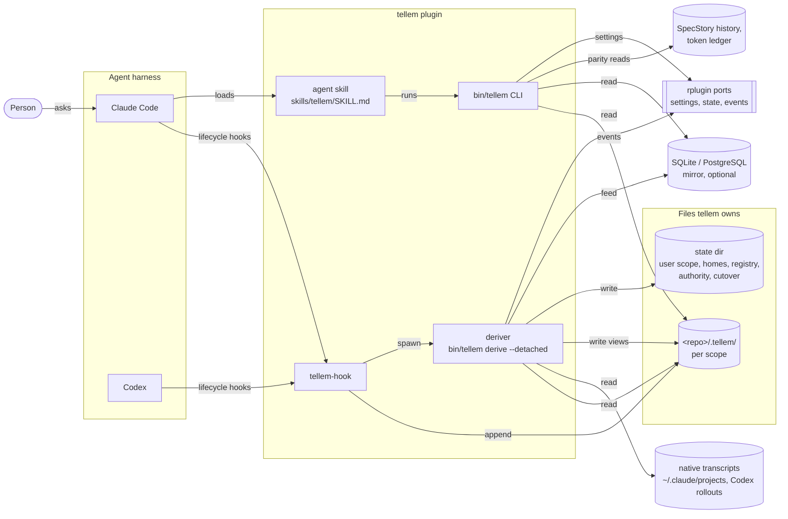

| Element | Responsibility | Never does |
|---|---|---|
| `tellem-hook` | Append one metadata line per lifecycle event; spawn the deriver on boundary events | Load gems, read transcripts, block on a lock it does not own, fail the harness |
| deriver | Turn raw lines and native transcripts into derived records, transcripts, pointers, views, mirror rows | Run inside the harness's process tree; write outside the scopes a session touched and tellem's state |
| CLI | Answer reports from derived records or a mirror; plan and apply control changes | Mutate a record outside a confirmed plan |
| skill | Map a question to the command that answers it | Edit `.tellem/` |

## 2. Components

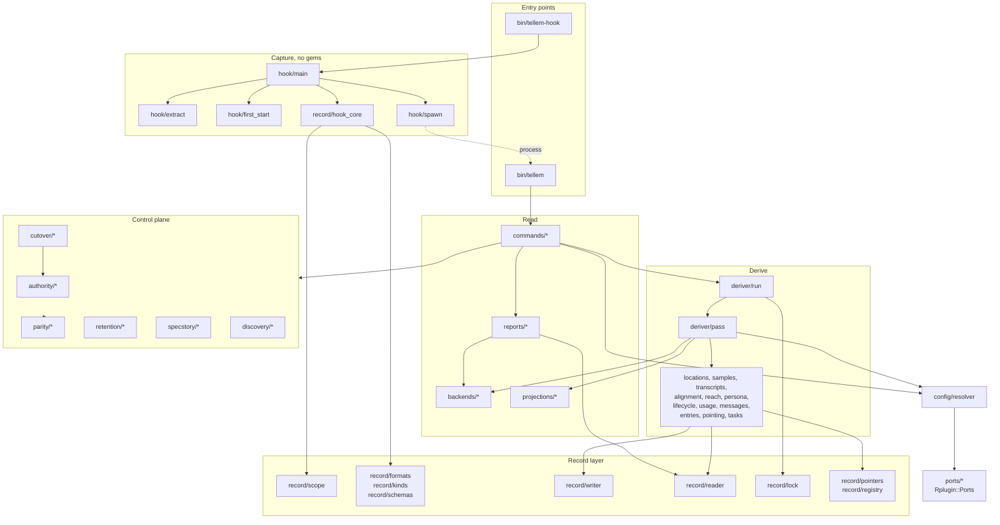

The hook path (`hook/*`, `record/hook_core`, `record/scope`, `record/formats`)
loads with `ruby --disable-gems` and must stay inside the latency budget that
`tellem health` reports (`hook_ms` p99 under 50 ms). Everything that needs the
library runs in the deriver or the CLI.

## 3. Capture path: one hook invocation

The harness runs `tellem-hook <event> <harness>` with the event payload on
stdin. `SessionStart`, `UserPromptSubmit`, `PostToolUse`,
`PostToolUseFailure`, `SubagentStart`, and `SubagentStop` run it with
`async: true` and a 30 s timeout; `Stop` and `SessionEnd` run it synchronously
with a 2 s timeout so the last lines land before the harness exits.

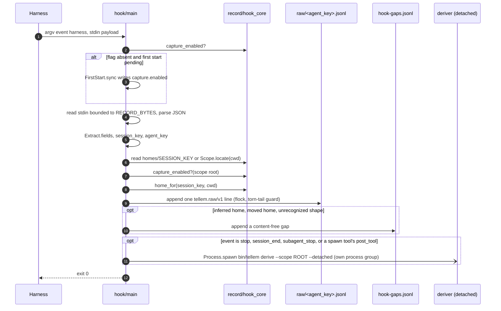

Every refusal or error on this path becomes a gap record and exit 0. The hook
never makes the harness fail.

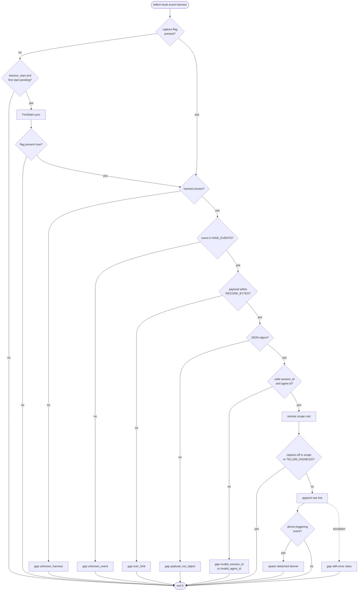

## 4. Scope resolution

A scope is where a session's record lives: the main working tree of a git
repository, or the user scope under tellem's state dir. The first hook of a
session fixes it in `homes/<session_key>`, so every later event of that session,
from any directory, lands in the same scope.

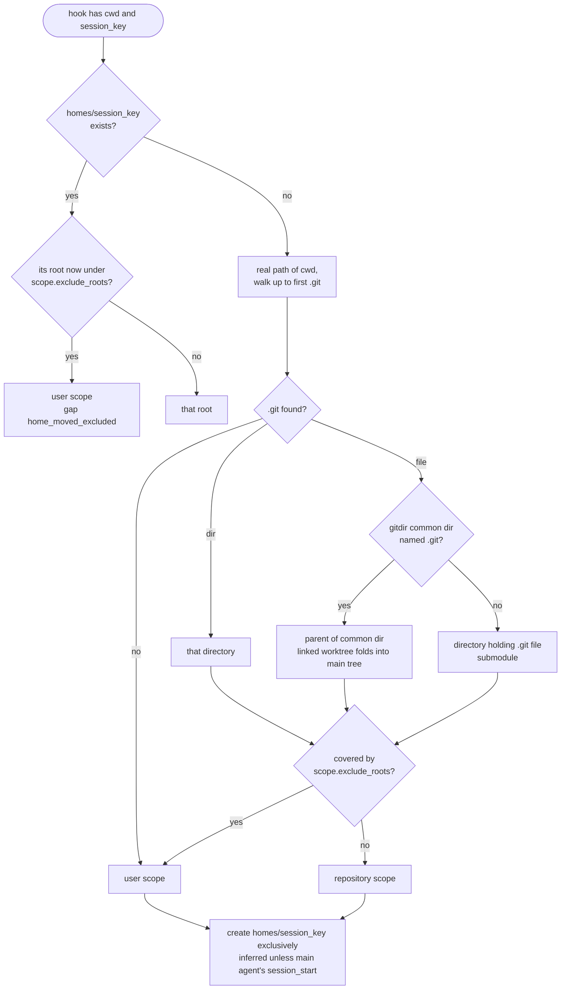

No git process runs on this path. Other repositories a session touches do not
become its home; the deriver writes a pointer into each of them instead
(section 7).

## 5. Derive path

`bin/tellem derive --scope ROOT` (`deriver/run`) is started detached by the hook
and in-process by a report's refresh. One deriver works on a scope at a time.

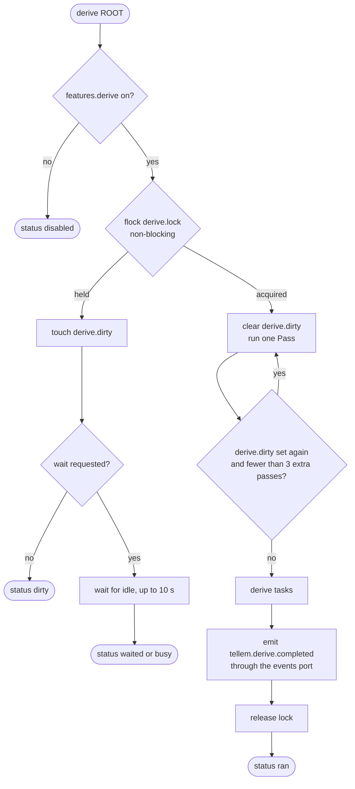

A held lock is never waited on by the hook path: the second deriver marks the
scope dirty and exits, and the holder runs again before it releases. A burst of
hooks therefore costs at most four passes per scope.

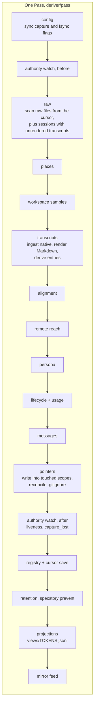

Each per-session step runs inside a guard: an exception marks that session
failed for the rest of the pass, records a `derive_error` gap, and leaves the
other sessions and the cursor of the failed one untouched, so the next pass
retries it. Derived records are flushed after every step.

## 6. Read path: a report

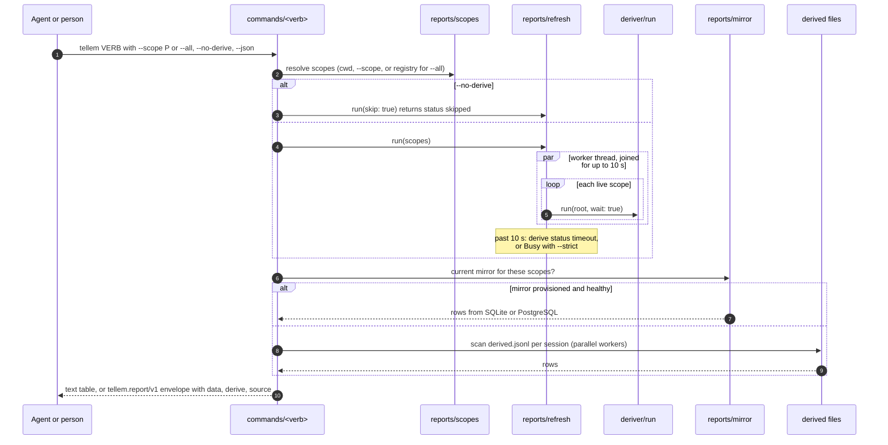

Files and mirror return the same rows for the same query; `source:` in the
footer (or `source` in JSON) says which answered. `--all` reads the scope
registry, so it reaches every repository a session ever lived in or pointed to.

## 7. Storage layout and record relationships

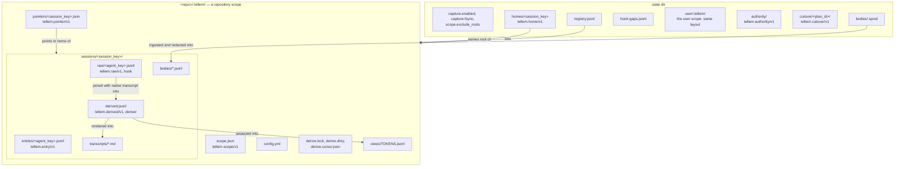

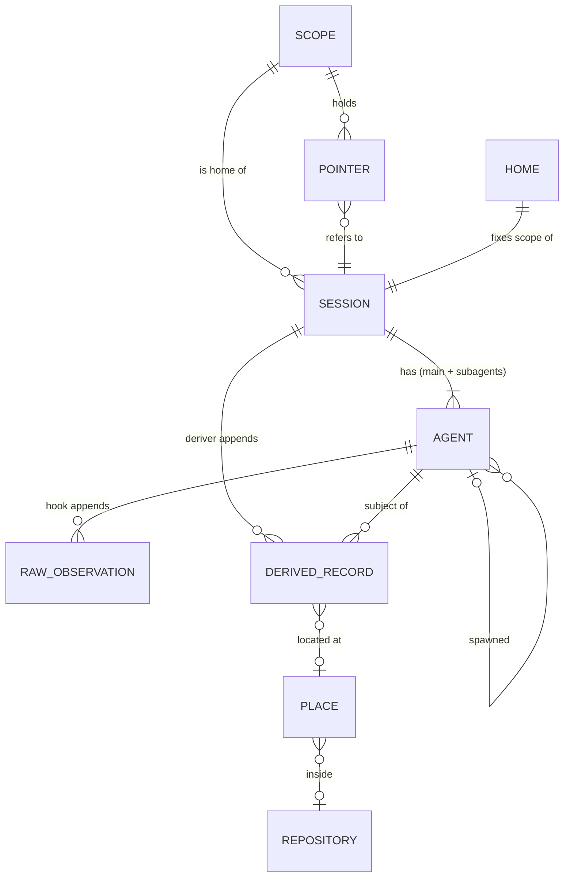

Field-level definitions of each record, its kinds, identifiers, and bounds are
in [`specs/tellem.yml`](../specs/tellem.yml).

## 8. Durability and concurrency

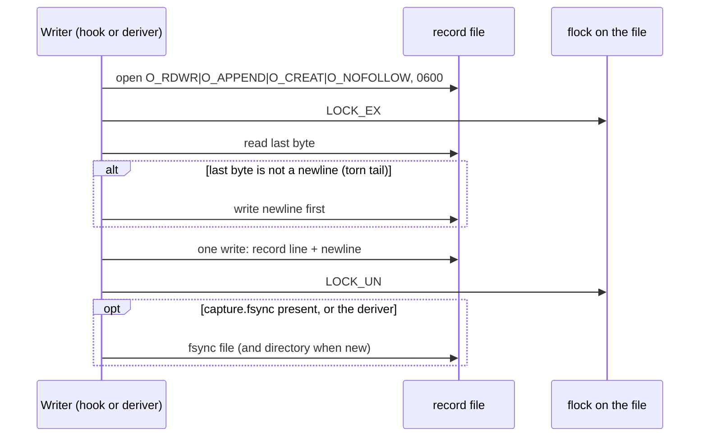

| Concern | Mechanism |
|---|---|
| Concurrent hooks on one file | `flock(LOCK_EX)` per append, one `write` per line |
| A writer killed mid-line | next writer starts a new line; readers count the fragment as torn and skip it |
| Concurrent derivers on one scope | `derive.lock` non-blocking; loser sets `derive.dirty`; holder re-runs up to 3 extra passes |
| Replays | derived records carry content ids; `Writer.append_derived` appends only unseen ids |
| Reader progress | per-file cursor `{inode, offset}`; a changed inode or short file restarts at 0 |
| Crash before fsync | hook lines are in the kernel when `append` returns; the deriver fsyncs raw files before it saves a cursor |
| Whole-file replacement | `replace_atomic`: temp file in the same directory, fsync, rename, fsync directory |
| Symlink attacks | every record file and `.tellem` directory opened `O_NOFOLLOW`; a symlink is refused |

## 9. Authority levels

Authority says who holds a harness's transcript. Each harness has one level.
Raising it is a reviewed plan; lowering happens by plan, by rollback, or on its
own when capture is lost.

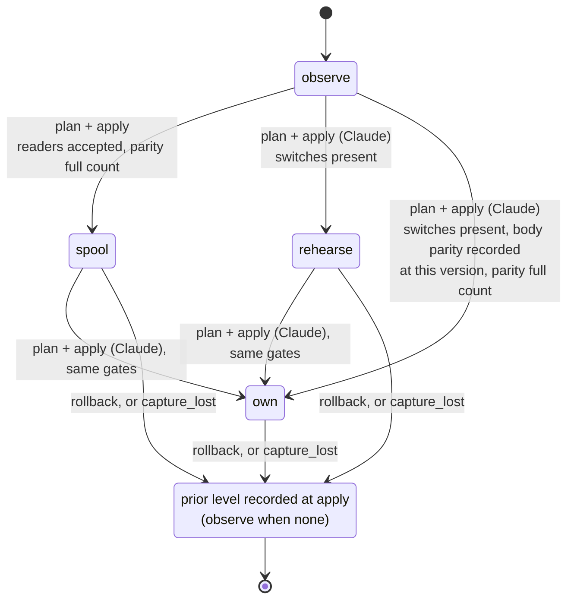

A lost capture lowers the harness automatically to the level recorded before
the plan that raised it, writes a receipt to `authority/receipts.jsonl`, emits
`tellem.authority.lowered`, and raises a `tellem doctor` finding. The stop
switch (`tellem authority stop`) blocks every raise until
`tellem authority resume`.

| Level | Native transcript | tellem | Codex |
|---|---|---|---|
| observe | written and expired by the harness | reads it | yes |
| spool | written by the harness | removes each session's files once its record is verified | yes (ceiling) |
| rehearse | written by the harness | also captures request bodies, to prove body parity | no |
| own | not written | captures from the body spool only | no |

## 10. Cutover plan and apply

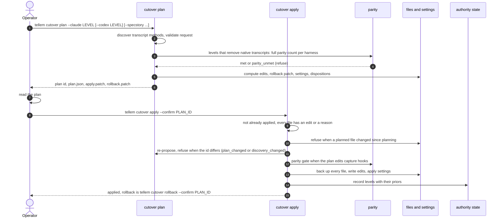

## 11. Invariants

1. The hook exits 0 for every input and never waits on a deriver.
2. The hook writes only raw lines, gap lines, a session's home file, and, on a
   pending first start, the capture flag or its settled marker.
3. Records are append-only; the only rewrites are whole-file atomic
   replacements of cursors, views, pointers, and settings mirrors.
4. Every timestamp is UTC RFC 3339 with milliseconds and `Z`, so string order
   is time order.
5. A derived record's id is a hash of its schema, kind, and identity fields, so
   deriving twice changes nothing.
6. Tokens are what the provider reported; a missing report is a gap, never an
   estimate.
7. Nothing leaves the machine except through a mirror the operator provisioned
   or the events port the host configured.
8. Nothing that removes native data runs without a confirmed plan whose id
   still matches the host.
