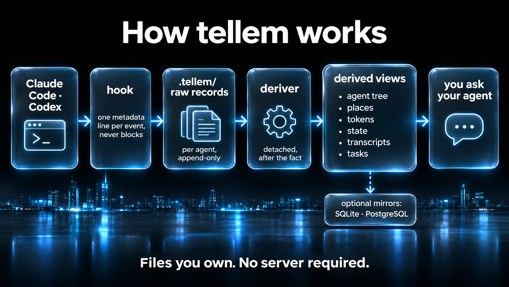
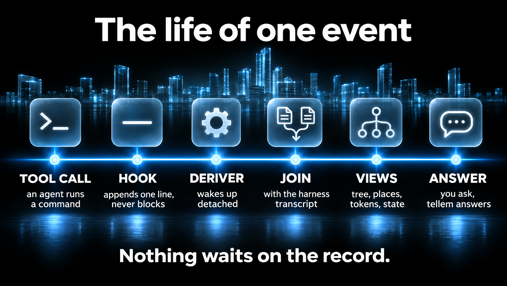
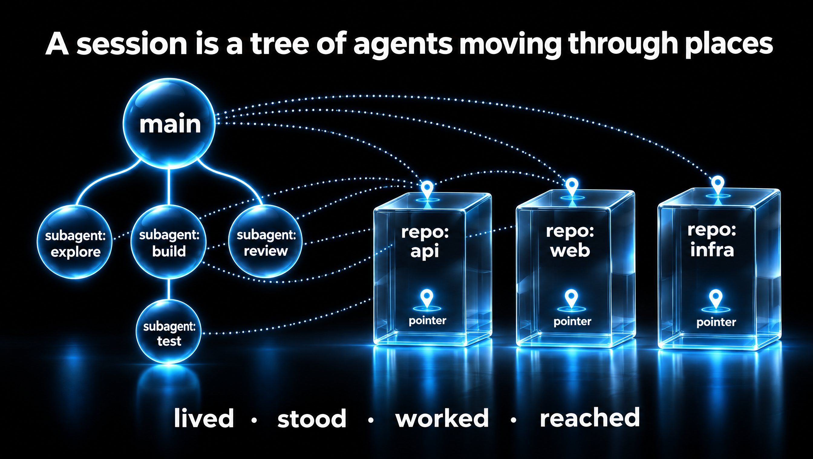
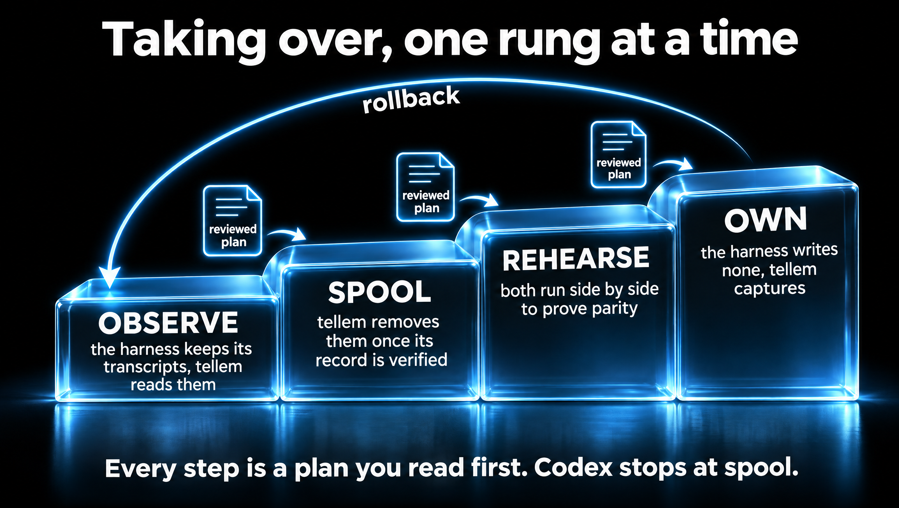

# How tellem works

This page walks through tellem's design with four figures: the pipeline, the
life of one event, the shape of a session, and the ladder for taking over from
other recorders. The exact record formats are in
[reference/formats.md](reference/formats.md), the decisions behind them in
[adr/](adr/), and the contract in
[../specs/tellem.app.yml](../specs/tellem.app.yml).

## The pipeline

tellem has three moving parts, and each does one job.

- **The hook** runs inside Claude Code and Codex on every lifecycle event:
  session start and end, each prompt, each tool call and its result, each
  subagent start and stop. It appends one metadata line to the session's raw
  record and exits. It loads no gems, holds no lock the agent waits on, and has
  a latency budget that `tellem health` reports against.
- **The raw record** lives in `.tellem/sessions/<session>/raw/`, one
  append-only file per agent, in the repository where the session started.
  It is metadata: event, time, agent, working directory, tool name, and the
  ids that join it to the agent app's own transcript. Content comes from that
  transcript, not from the hook.
- **The deriver** starts detached once the hook has written, catches up on
  every scope that changed, and writes the derived views: the agent tree,
  places and pointers, tokens, state, messages between agents, task turns, and
  Markdown transcripts. It is the only part that reads transcripts and the only
  part that does real work.

Every report reads the derived views, from the files or from a SQLite or
PostgreSQL mirror when one is provisioned, with the same output either way.
The agent skill maps a plain-language question to the report that answers it.

## The life of one event

1. **Tool call.** An agent runs a command.
2. **Hook.** The harness fires `PostToolUse`; the hook appends one line and
   returns. Most events run the hook asynchronously; `Stop` and `SessionEnd`
   run it synchronously with a 2 s limit so the last lines land.
3. **Deriver.** A detached deriver wakes, takes the scope's lock, and reads
   the new raw lines from its cursor.
4. **Join.** It matches them to the harness transcript by session, agent, and
   request ids, which brings in the prompt and reply text, the model, and the
   token counts the provider reported.
5. **Views.** It updates the session's derived records and transcripts, and
   writes a pointer into every other repository the session touched.
6. **Answer.** The next time anyone asks, the report reads the views. A read
   brings its scope up to date first, unless `--no-derive` is passed.

Nothing waits on the record. A late or failed derive shows up as a gap or lag
in `tellem health`, never as a slow agent.

## A session is a tree of agents moving through places

Each session is a tree. The main agent is the root; every subagent it spawns
is a child, with its type, model, and spawn and stop times. Messages between
parent and child are recorded both ways, so `tellem messages` shows what each
one actually said and received. The figure is an illustration; the depth a
tree reaches depends on the agent app.

Each agent moves through places, recorded with four verbs:

| Verb | Meaning |
|---|---|
| lived | the repository the session started in, where its record is kept |
| stood | the working directory at each moment |
| worked | files it read or wrote |
| reached | anything it touched outside its repository |

A repository the session worked in or reached gets a pointer under
`.tellem/pointers/`, naming the session and where its record lives. That is how
`tellem sessions` in one repository finds a session that started in another.

## Taking over, one rung at a time

Out of the box, tellem records beside whatever already records your sessions
(the agent app's own transcripts, SpecStory, a token ledger) and changes none
of it. That is shadow mode at the `observe` level. Each harness has its own
level:

| Level | Who writes the transcript | What tellem does |
|---|---|---|
| observe | the harness, which keeps and expires its own files | reads them |
| spool | the harness | removes each session's native files once tellem's record of it is verified |
| rehearse | the harness, and tellem from the request bodies | compares both over real sessions to earn body parity |
| own | tellem only, from the bodies the harness delivers | the harness writes no transcript |

Codex can reach `spool` at most: interactive Codex has no switch that stops it
writing rollouts.

Every move is `tellem cutover plan`, read by a person, then
`tellem cutover apply --confirm PLAN_ID`, with a rollback plan written at the
same time. A level that removes native transcripts needs parity first: the
last 20 shadowed Claude sessions, and the last 5 Codex sessions where Codex
sessions have a reference, must match what the incumbent recorded
(`tellem parity --all`). A lost capture drops a harness back a level on its
own and raises a `tellem doctor` finding.
